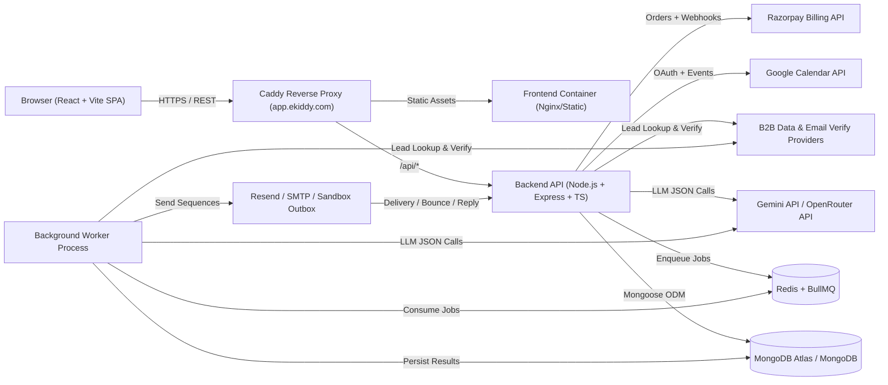

# Ekiddy Outreach AI — Technical Architecture

## 1. High-Level System Architecture



---

## 2. Monorepo Directory Structure

```text
EKIDDY OUTREACH AI/
├── shared/                     # @ekiddy/shared: Zod schemas, TS interfaces, credit catalog, constants
├── backend/                    # Express REST API, Mongoose models, BullMQ workers, service integrations
│   ├── src/
│   │   ├── config/             # Environment validation, DB, Redis/Queue bootstrap
│   │   ├── middleware/         # Auth, Org RBAC, Zod validation, rate-limit, error handler, audit
│   │   ├── models/             # All 24 Mongoose schemas with tenant & query indexes
│   │   ├── modules/            # Feature controllers & routes (auth, research, campaigns, inbox, etc.)
│   │   ├── services/           # AI provider, SSRF-safe crawler, B2B data, email, calendar, razorpay
│   │   ├── workers/            # BullMQ job handlers & scheduler loops
│   │   ├── utils/              # AES-256-GCM crypto, SSRF URL guard, CSV, DNS checks, logger
│   │   └── app.ts / server.ts / worker.ts
│   └── tests/                  # Vitest + Supertest integration & security isolation suites
├── frontend/                   # React + Vite + TypeScript + Tailwind CSS SPA
│   ├── src/
│   │   ├── components/         # Reusable design system + layout shell + feature widgets
│   │   ├── hooks/              # TanStack Query hooks & theme/auth helpers
│   │   ├── lib/                # API client, error formatting, validators
│   │   ├── pages/              # Public landing, auth, onboarding, dashboard modules, booking page
│   │   ├── stores/             # Zustand auth, org, theme, toast, and UI state stores
│   │   └── tests/              # Vitest + React Testing Library specs
│   └── e2e/                    # Playwright end-to-end specs
├── infrastructure/             # Caddyfile, backup scripts, deployment configs
├── docs/                       # Operational deployment & security runbooks
├── docker-compose.yml          # Multi-service production/staging orchestration
├── .env.example                # Complete documented environment template
└── *.md                        # Core architectural & project documentation
```

---

## 3. Core Architectural Subsystems

### 3.1 Multi-Tenancy & RBAC
- Users authenticate via JWT (or Firebase ID token exchange when `FIREBASE_PROJECT_ID` is configured) and select an active Organization (`x-organization-id` header or user's `defaultOrganizationId`).
- Membership roles: `owner`, `admin`, `member`, `viewer`.
- Sensitive endpoints (`billing`, `integrations`, `team`, `campaign activation`, `autopilot actions`) verify role permissions and write immutable entries to `AuditLog`.

### 3.2 Background Queue & Worker Layer
- Uses **BullMQ** backed by **Redis** in production and Docker (`worker.ts` runs independently from `server.ts`).
- When `REDIS_URL` is absent in local development or tests, a BullMQ-compatible in-process job dispatcher preserves async state transitions, progress percentages (`0–100`), retries, idempotent job keys, and cancellation semantics using MongoDB `JobRecord` tracking.
- Dedicated queues:
  - `company-research`, `competitor-discovery`, `icp-generation`
  - `company-search`, `people-search`, `contact-enrichment`, `email-verification`
  - `ai-email-generation`, `campaign-scheduler`, `email-delivery`, `follow-up-sequence`
  - `inbox-sync`, `analytics-aggregation`

### 3.3 AI Provider Abstraction
- Unified `AIService` supporting **Google Gemini API** and **OpenRouter API** with structured JSON output enforcement (Zod schema validation of model outputs) and automatic provider fallback when primary fails or rate-limits.
- Organization-level model overrides and encrypted custom API keys are supported; when neither platform nor org keys are configured, a deterministic `demo` fallback returns clearly flagged structured outputs without pretending a live LLM API key is active.

### 3.4 Security Controls
- **SSRF Guard**: Rejects non-HTTP(S) schemes, credentials in URLs, private/loopback/link-local/CGNAT/metadata IPv4 & IPv6 ranges (pre- and post-DNS resolution, and across redirects), caps response payload size, and enforces strict request timeouts.
- **Credential Encryption**: All third-party credentials (SMTP/Resend, B2B data keys, Google OAuth refresh tokens, org AI keys) are encrypted using AES-256-GCM with per-record random IVs and authentication tags; secret fields are never serialized in API responses.
- **Webhook Verification**: Razorpay webhooks verify `X-Razorpay-Signature` via HMAC-SHA256; email webhooks verify provider signing secrets using constant-time comparison (`crypto.timingSafeEqual`).
- **Rate Limiting & Helmet**: Global and auth-specific rate limits, CORS allowlists, strict Helmet security headers, and centralized error sanitization.
